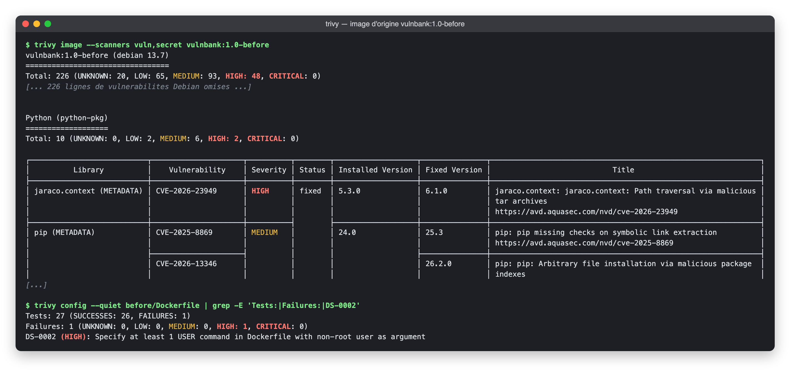
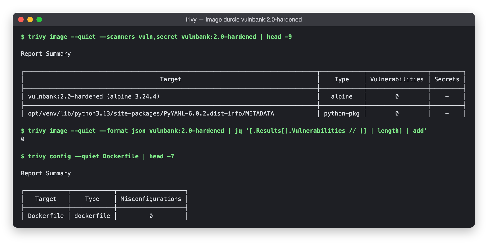
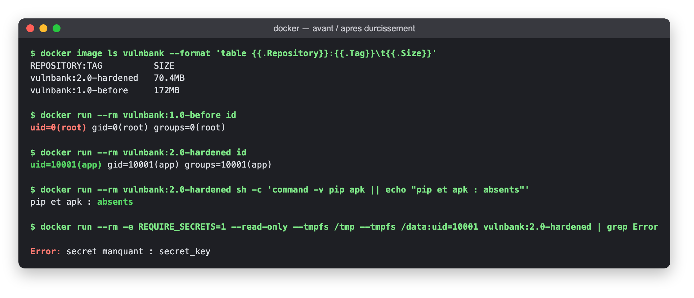
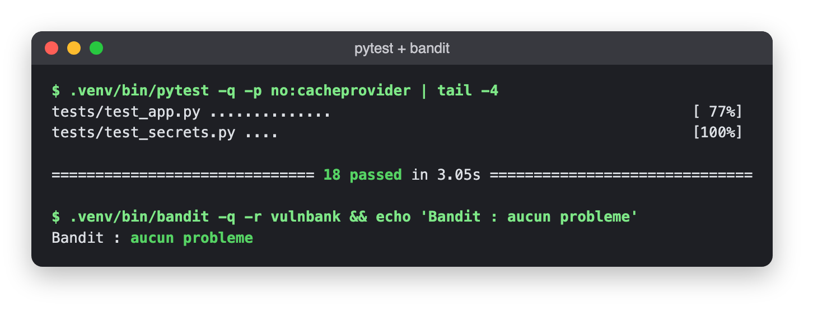
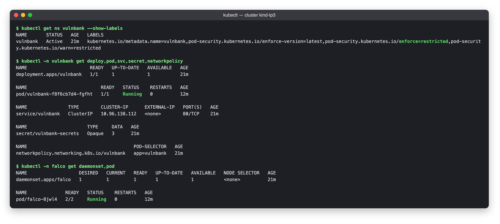
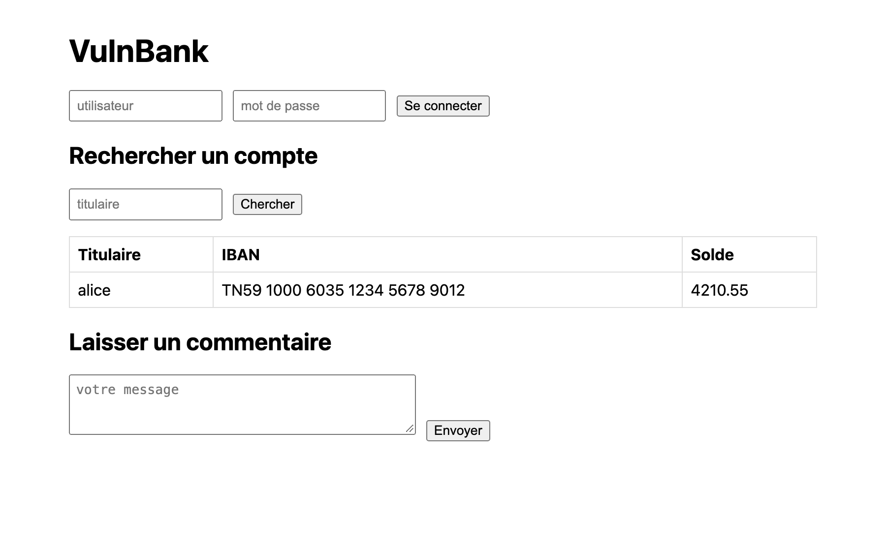
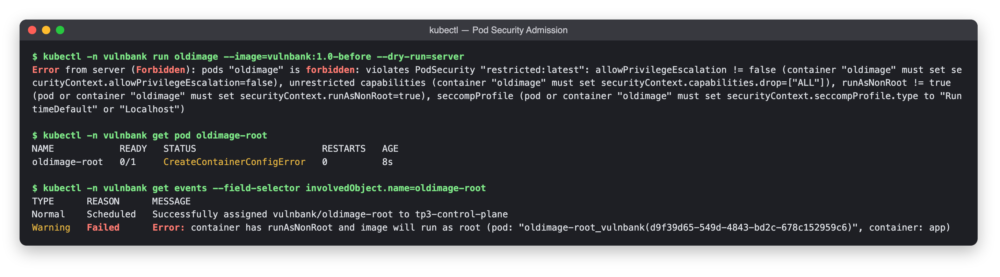
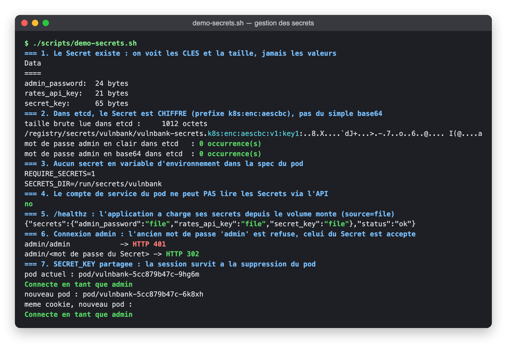
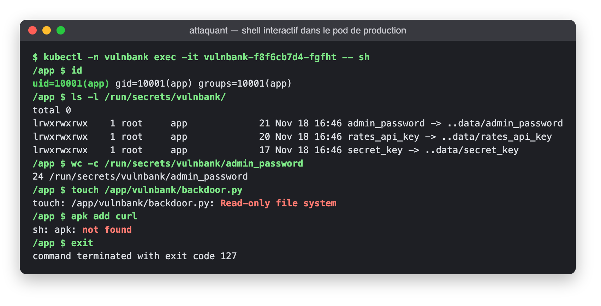
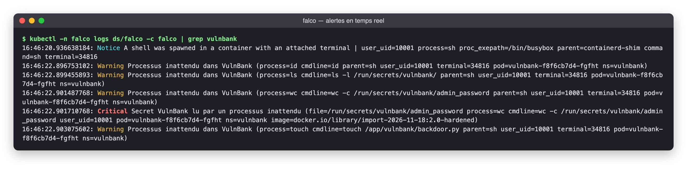

<p align="center">
  
</p>

<h1 align="center">TP 3 : Sécurité des Conteneurs et Monitoring en Runtime</h1>
<h3 align="center">Compte rendu — Image Docker durcie, Secrets Kubernetes et détection d'intrusion avec Falco</h3>

<p align="center">
  <b>Réalisé par :</b><br>
  Youssef Khalifa<br>
  Hanine Khemir<br>
  Oussema Said<br>
  Ahmed Amine Bououd
</p>

<p align="center">
  <b>Classe :</b> GL4 — Groupe 1
</p>

<div class="pagebreak"></div>

---

**Dépôt :** https://github.com/HanineKhemir/devsecops-tp3-container-security
 · **TP2 :** https://github.com/HanineKhemir/devsecops-tp2-cicd
 · **TP1 :** https://github.com/HanineKhemir/devsecops-tp1-sast-sca

**Application :** VulnBank (Flask + SQLite), l'application corrigée au TP1 puis protégée par le pipeline du TP2.

**Outils :** Docker, Trivy 0.76.2, kind (Kubernetes v1.36.1), Helm 4, Secrets Kubernetes + chiffrement etcd, Falco 0.45.2 (pilote modern eBPF)

**Preuves :** toutes les sorties citées dans ce rapport sont dans le dossier [`evidence/`](evidence/). Elles ont été produites par les scripts du dossier [`scripts/`](scripts/).

**Figures :** les captures « terminal » sont les sorties réelles des commandes, enregistrées par [`scripts/capture-terminals.sh`](scripts/capture-terminals.sh) puis mises en forme par [`scripts/render_terminals.py`](scripts/render_terminals.py) (couleurs ajoutées, texte inchangé ; `[...]` marque une coupure).

---

## 1. Le problème

Aux TP1 et TP2, nous avons sécurisé le **code** de VulnBank et ses **dépendances Python**. Mais en production, ce qui tourne n'est pas le code : c'est une **image Docker** sur un **cluster**. Trois questions restaient sans réponse :

| Question | Partie du TP |
|---|---|
| L'image elle-même (système, outils, utilisateur) est-elle sûre ? | 2. Sécurité de l'image |
| Où sont les mots de passe et les clés, et qui peut les lire ? | 3. Gestion des secrets |
| Si un attaquant entre malgré tout dans le conteneur, le voit-on ? | 4. Surveillance au runtime |

---

## 2. Sécurité de l'image Docker

### 2.1 Scan de l'image d'origine

L'image du TP2 ([`before/Dockerfile`](before/Dockerfile)) a été construite (`vulnbank:1.0-before`) puis scannée :

```bash
trivy image --scanners vuln,secret vulnbank:1.0-before
trivy config before/Dockerfile
```

| Cible | CRITICAL | HIGH | MEDIUM | LOW | UNKNOWN | Total |
|---|---|---|---|---|---|---|
| Système Debian 13 (`python:3.11-slim`) | 0 | 48 | 93 | 65 | 20 | **226** |
| Paquets Python de l'image | 0 | 2 | 6 | 2 | 0 | **10** |
| **Total (vulnérabilités paquet × CVE)** | **0** | **50** | **99** | **67** | **20** | **236** |

Trivy compte une ligne par **paquet** touché : une même CVE de `util-linux` apparaît par exemple sous 9 paquets (`mount`, `libblkid1`, `login`…). En **CVE distinctes**, l'image contient **111 CVE** (14 HIGH, 51 MEDIUM, 37 LOW, 9 UNKNOWN). Dans la suite, « vulnérabilités » désigne le décompte de Trivy (236).

Rapport complet : [`evidence/trivy-before.txt`](evidence/trivy-before.txt) et [`evidence/trivy-before.json`](evidence/trivy-before.json).

<p align="center"><br><em>Figure 1 — Scan Trivy de l'image d'origine : 226 + 10 vulnérabilités, et le Dockerfile signalé (DS-0002, conteneur root)</em></p>

### 2.2 Failles identifiées

1. **Une image de base trop grosse.** 226 des 236 vulnérabilités (101 CVE distinctes) viennent de paquets Debian dont l'application n'a pas besoin (`util-linux`, `mount`, `login`, `ncurses`…). Sur les 12 CVE HIGH distinctes du système, **une seule** a un correctif disponible : on ne peut pas « mettre à jour pour s'en débarrasser », il faut **retirer** ces paquets.
2. **Les outils d'installation sont livrés en production.** Les 10 vulnérabilités Python ne touchent **pas** nos dépendances (corrigées au TP1/TP2) mais `pip 24.0` (6 CVE), `wheel 0.45.1` (CVE-2026-24049, HIGH, exécution de code), `setuptools 79.0.1` et `jaraco.context` (CVE-2026-23949, HIGH, traversée de chemin). Ce sont des outils de **construction** : ils n'ont rien à faire dans l'image d'exécution.
3. **Le conteneur tourne en root** (`docker run vulnbank:1.0-before id` → `uid=0(root)`). Trivy config le signale : `DS-0002 (HIGH): Specify at least 1 USER command in Dockerfile with non-root user`. Une faille d'exécution de code dans l'application donnerait directement root dans le conteneur.
4. **Serveur de développement en production :** `python -m vulnbank.app` lance le serveur intégré de Flask, que la documentation Flask déconseille en production.
5. **Image de base non épinglée :** `FROM python:3.11-slim` peut changer d'un build à l'autre sans que personne ne le voie.
6. **Pas de `.dockerignore` :** tout le dossier (`.git`, `.venv`, base `bank.db`, rapports…) part dans le contexte de build, avec le risque d'embarquer un fichier sensible par un `COPY` trop large.

### 2.3 Le Dockerfile sécurisé

Fichier : [`Dockerfile`](Dockerfile). Changements effectués :

| # | Changement | Pourquoi |
|---|---|---|
| 1 | Base **`python:3.13-alpine`** au lieu de `python:3.11-slim` | Alpine ne contient que musl, busybox et quelques bibliothèques : il n'y a plus de paquets inutiles qui portent des CVE. |
| 2 | Base **épinglée par digest** (`@sha256:9ef1a5…`) | Build reproductible : l'image de base ne peut pas changer sans modification visible du Dockerfile. |
| 3 | **Build multi-étapes** (`builder` → `runtime`) | Les dépendances sont installées dans un venv à l'étape `builder` ; seul le venv est copié dans l'image finale. |
| 4 | **Suppression de `pip`, `setuptools`, `wheel`, `ensurepip` et `apk`** dans l'image finale | Plus d'outils d'installation : les vulnérabilités de pip/wheel/setuptools disparaissent, et un attaquant ne peut plus installer d'outils (`apk add curl` → `apk: not found`, voir §4). |
| 5 | `apk upgrade` au build | Applique les correctifs de sécurité publiés depuis la création de l'image de base (ex. `zlib`). |
| 6 | **Utilisateur non-root `app` (UID/GID 10001)**, sans shell de connexion, `USER 10001:10001` numérique | Le processus n'a plus les droits root. L'UID numérique permet à Kubernetes de vérifier `runAsNonRoot`. |
| 7 | Code copié avec `--chown=root:root --chmod=0755` | L'utilisateur `app` peut lire et exécuter le code, mais **pas le modifier** (pas de porte dérobée dans le code). |
| 8 | Base SQLite déplacée vers `/data` (`VULNBANK_DB_PATH`) | Permet de rendre tout le reste du système de fichiers **en lecture seule** à l'exécution (`readOnlyRootFilesystem`). |
| 9 | **Gunicorn** au lieu de `app.run()`, en forme exec JSON, `--no-control-socket` | Serveur WSGI de production ; gunicorn est le PID 1 et reçoit les signaux d'arrêt. Pas de socket d'administration. |
| 10 | **Port 8000** au lieu de 5000 | Port non privilégié : aucune capacité Linux nécessaire. |
| 11 | `HEALTHCHECK` sur `/healthz` | Docker (et Kubernetes via ses sondes) savent si l'application répond vraiment. |
| 12 | **`.dockerignore`** strict | `.git`, `.venv`, `*.db`, `.env`, `secrets/`, tests, rapports… ne sont jamais envoyés au build. |
| 13 | Aucun secret dans l'image (ni `ENV`, ni fichier) | Les secrets sont fournis à l'exécution par Kubernetes (partie 3). Trivy `--scanners secret` : 0 secret trouvé ([`trivy-after.json`](evidence/trivy-after.json)). |

### 2.4 Résultat

```bash
trivy image --scanners vuln,secret vulnbank:2.0-hardened
trivy config Dockerfile
```

| | Avant (`1.0-before`) | Après (`2.0-hardened`) |
|---|---|---|
| Vulnérabilités système (Trivy) | 226 (dont 48 HIGH) | **0** |
| Vulnérabilités paquets Python | 10 (dont 2 HIGH) | **0** |
| CVE distinctes | 111 (dont 14 HIGH) | **0** |
| Secrets détectés dans l'image (Trivy) | 0 | 0 |
| Mauvaises configurations Dockerfile (Trivy) | 1 HIGH (`DS-0002`, root) | **0** |
| Utilisateur | `uid=0(root)` | `uid=10001(app)` |
| Taille | 172 Mo | **70,4 Mo** |
| Serveur | serveur de dev Flask | Gunicorn |
| `pip` / `apk` dans l'image | oui / — | non / non |

Preuves : [`evidence/trivy-after.txt`](evidence/trivy-after.txt), [`evidence/trivy-config-before.txt`](evidence/trivy-config-before.txt), [`evidence/trivy-config-after.txt`](evidence/trivy-config-after.txt).

<p align="center"><br><em>Figure 2 — Scan Trivy de l'image durcie : 0 vulnérabilité, 0 mauvaise configuration</em></p>

<p align="center"><br><em>Figure 3 — Taille, utilisateur, outils absents et refus de démarrer sans secret</em></p>

**Ce que le choix d'Alpine seul n'aurait pas suffi à corriger :** l'image de base `python:3.13-alpine` brute contient encore **9 vulnérabilités** (1 MEDIUM sur `zlib`, et 8 — dont 5 HIGH — dans les bibliothèques que `pip` embarque dans `pip/_vendor/` : `urllib3` 2.7.0, `msgpack` 1.1.2 et `setuptools` 70.3.0, présent sous forme de `pkg_resources` d'après `pip/_vendor/vendor.txt` ; voir [`evidence/trivy-base-alpine.txt`](evidence/trivy-base-alpine.txt)). Ce sont les étapes 4 et 5 (suppression des outils d'installation + `apk upgrade`) qui amènent le total à zéro.

**Limite assumée :** l'image garde le shell `busybox` (`sh`). Une image *distroless* l'aurait supprimé et serait encore plus stricte. Nous l'avons gardé volontairement pour la partie 3 : il faut un shell pour simuler l'intrusion demandée par le sujet. Sur une image distroless, la règle Falco « processus inattendu » (§4.2) resterait la protection pertinente.

**« 0 CVE » est un état à une date, pas une garantie :** de nouvelles CVE sont publiées chaque semaine (comme au TP2 pour `certifi`). Le scan Trivy doit donc être ajouté au pipeline du TP2 pour être relancé à chaque build.

---

## 3. Gestion des secrets

### 3.1 Les secrets de VulnBank

| Secret | Situation au TP2 | Situation au TP3 |
|---|---|---|
| `secret_key` (signe les cookies de session) | variable d'env., **sinon clé aléatoire** générée au démarrage | Secret Kubernetes, **obligatoire** |
| `admin_password` | **`"admin"` écrit en dur** dans `db.py` | Secret Kubernetes, **obligatoire** |
| `rates_api_key` (clé d'accès de l'API de taux de change) | absente | Secret Kubernetes (ici une valeur fictive générée par le script, sauf si `RATES_API_KEY` est fourni) |

Le repli « clé aléatoire » du TP2 avait deux défauts : chaque redémarrage invalidait toutes les sessions, et une application **sans** secret démarrait quand même sans que personne ne s'en aperçoive.

### 3.2 Les secrets sortent du code

Nouveau module [`vulnbank/secrets_loader.py`](vulnbank/secrets_loader.py). `read_secret(nom)` cherche :

1. le **fichier** `$SECRETS_DIR/nom` (volume Secret Kubernetes monté en lecture seule) ;
2. sinon la variable d'environnement `NOM` (développement local) ;
3. sinon, si `REQUIRE_SECRETS=1` (production) : **le démarrage échoue** avec `Error: secret manquant : secret_key` ([`evidence/failfast-missing-secret.txt`](evidence/failfast-missing-secret.txt)). Le message contient le nom du secret, jamais sa valeur.

Nous montons les secrets en **fichiers** et non en variables d'environnement : une variable apparaît dans `/proc/<pid>/environ`, elle est héritée par tous les processus fils et souvent copiée dans les logs. Un fichier monté vit sur un `tmpfs` (jamais écrit sur le disque du nœud), avec des droits restreints (`0440`), et il est mis à jour automatiquement si le Secret change.

`/healthz` indique **d'où** vient chaque secret (`file`, `env`, `absent`) sans jamais en révéler la valeur. 4 nouveaux tests ([`tests/test_secrets.py`](tests/test_secrets.py)) vérifient cet ordre de recherche, l'échec en cas d'absence, et que `admin/admin` ne fonctionne plus : **18 tests sur 18 passent** et Bandit ne signale rien.

<p align="center"><br><em>Figure 4 — Tests de non-régression (dont les 4 tests de secrets) et analyse Bandit</em></p>

### 3.3 Déploiement sur Kubernetes

Cluster local **kind** (Kubernetes v1.36.1). Manifestes dans [`k8s/`](k8s/) :

| Fichier | Rôle sécurité |
|---|---|
| [`kind-config.yaml`](k8s/cluster/kind-config.yaml) | Active le **chiffrement des Secrets au repos** dans etcd (AES-CBC). Par défaut, un Secret n'est que du base64 dans etcd. La clé est générée par [`gen-encryption-config.sh`](scripts/gen-encryption-config.sh) et exclue de Git. |
| [`00-namespace.yaml`](k8s/00-namespace.yaml) | Pod Security Admission **`restricted` imposé** : tout pod root, privilégié ou avec des capacités est refusé. |
| [`01-rbac.yaml`](k8s/01-rbac.yaml) | Compte de service dédié, **sans jeton monté et sans aucun droit**. |
| [`secret.example.yaml`](k8s/secret.example.yaml) | **Modèle uniquement** (aucune vraie valeur dans Git). |
| [`02-deployment.yaml`](k8s/02-deployment.yaml) | Secret monté en fichiers (`/run/secrets/vulnbank`, lecture seule, mode `0440`) ; `runAsNonRoot`, UID 10001, `readOnlyRootFilesystem`, `allowPrivilegeEscalation: false`, `capabilities: drop ALL`, `seccompProfile: RuntimeDefault`, limites CPU/mémoire, sondes `/healthz`, tag d'image immuable. |
| [`03-networkpolicy.yaml`](k8s/03-networkpolicy.yaml) | Entrée limitée au port 8000 ; sortie limitée au DNS et au HTTPS. |

Le vrai Secret est créé par [`scripts/create-secret.sh`](scripts/create-secret.sh) : les valeurs sont **générées aléatoirement** (`openssl rand`), écrites dans un dossier temporaire en mode `0600`, passées à `kubectl create secret --from-file`, puis effacées. Elles ne passent ni par Git, ni par l'historique du shell, ni par la ligne de commande (visible dans `ps`).

`trivy config k8s/` : **0 mauvaise configuration** ([`evidence/trivy-config-k8s.txt`](evidence/trivy-config-k8s.txt)).

<p align="center"><br><em>Figure 5 — VulnBank et Falco déployés sur le cluster kind (namespace en profil restricted)</em></p>

<p align="center"><br><em>Figure 6 — L'application VulnBank déployée, vue dans le navigateur (via kubectl port-forward)</em></p>

Deux garde-fous empêchent un déploiement non sécurisé dans ce namespace :

- **Un pod sans contexte de sécurité est refusé dès l'admission** par Pod Security Admission ([`evidence/psa-reject-root.txt`](evidence/psa-reject-root.txt)) :
  ```
  pods "oldimage" is forbidden: violates PodSecurity "restricted:latest": allowPrivilegeEscalation != false,
  unrestricted capabilities, runAsNonRoot != true, seccompProfile ...
  ```
- **L'image d'origine (qui tourne en root) ne démarre pas**, même avec un contexte de sécurité conforme : `runAsNonRoot: true` impose au kubelet de vérifier l'utilisateur de l'image ([`evidence/root-image-blocked.txt`](evidence/root-image-blocked.txt)) :
  ```
  oldimage-root   0/1   CreateContainerConfigError
  Warning  Failed  Error: container has runAsNonRoot and image will run as root
  ```

<p align="center"><br><em>Figure 7 — Pod sans contexte de sécurité refusé ; image root bloquée par le kubelet</em></p>

### 3.4 Démonstration : l'application accède aux secrets en toute sécurité

Script [`scripts/demo-secrets.sh`](scripts/demo-secrets.sh), sortie complète dans [`evidence/demo-secrets.txt`](evidence/demo-secrets.txt). Aucune valeur de secret n'est affichée : on prouve leur utilisation par leurs **effets**.

| # | Vérification | Résultat observé |
|---|---|---|
| 1 | `kubectl describe secret` | on ne voit que les clés et leur taille (`admin_password: 24 bytes`…) |
| 2 | lecture brute dans **etcd** | la valeur commence par `k8s:enc:aescbc:v1:key1:` ; le mot de passe admin y apparaît **0 fois** en clair et **0 fois** en base64 |
| 3 | variables d'environnement du pod | seulement `REQUIRE_SECRETS=1` et `SECRETS_DIR=/run/secrets/vulnbank` |
| 4 | `kubectl auth can-i get secrets --as=system:serviceaccount:vulnbank:vulnbank` | **`no`** |
| 5 | `GET /healthz` | `{"secrets":{"admin_password":"file","rates_api_key":"file","secret_key":"file"},"status":"ok"}` |
| 6 | connexion `admin` / `admin` (mot de passe du TP2) | **HTTP 401** (refusé) |
| 6 | connexion `admin` / mot de passe du Secret | **HTTP 302** (connecté) |
| 7 | session ouverte, **suppression du pod**, même cookie sur le nouveau pod | `Connecte en tant que admin` avant **et** après |

<p align="center"><br><em>Figure 8 — Exécution de scripts/demo-secrets.sh</em></p>

Le point 7 prouve que la `SECRET_KEY` vient bien du Secret et non d'un repli aléatoire : avec une clé générée au démarrage (comportement du TP2), le nouveau pod aurait rejeté le cookie.

---

## 4. Surveillance au runtime avec Falco

### 4.1 Installation

Falco 0.45.2 est installé comme **DaemonSet** (un agent par nœud) avec Helm, valeurs dans [`k8s/falco/values.yaml`](k8s/falco/values.yaml) :

```bash
helm install falco falcosecurity/falco --version 9.2.2 -n falco --create-namespace -f k8s/falco/values.yaml
```

Nous utilisons le pilote **`modern_ebpf`** : Falco observe les appels système depuis le noyau grâce à eBPF, sans module noyau à compiler. C'est le pilote que nous avons validé sur le noyau `linuxkit` 7.0 de Docker Desktop utilisé par kind (pas de module noyau à compiler pour ce noyau). Les événements sont enrichis avec les métadonnées Kubernetes (pod, namespace, image).

En plus des règles officielles, nous avons écrit **deux règles propres à VulnBank** :

| Règle | Déclencheur | Priorité |
|---|---|---|
| `VulnBank secret read by unexpected process` | ouverture d'un fichier de `/run/secrets/vulnbank` par un autre processus que gunicorn/python | **CRITICAL** (MITRE T1552) |
| `VulnBank unexpected process in production container` | tout processus lancé dans le conteneur hors de la liste blanche (gunicorn, python) | WARNING |

### 4.2 Simulation de l'attaque

Script [`scripts/demo-falco.sh`](scripts/demo-falco.sh). Un attaquant ouvre un **shell interactif** dans le conteneur de production, puis tente de voler un secret, de déposer une porte dérobée et d'installer un outil :

<p align="center"><br><em>Figure 9 — Simulation d'attaque : shell interactif dans le conteneur de production</em></p>

Le durcissement de la partie 2 limite déjà les dégâts : l'attaquant n'est **pas root**, il **ne peut pas modifier** le code (système de fichiers en lecture seule) et **ne peut pas installer** d'outils (`apk` supprimé).

### 4.3 Alertes générées par Falco

Extrait de `kubectl -n falco logs ds/falco` (sortie complète : [`evidence/demo-falco.txt`](evidence/demo-falco.txt)) :

<p align="center"><br><em>Figure 10 — Alertes Falco générées en temps réel pendant l'attaque</em></p>

- La règle officielle **« Terminal shell in container »** détecte l'ouverture du shell interactif, avec le pod, le namespace et l'image concernés.
- Nos règles personnalisées suivent **chaque commande** de l'attaquant, et lèvent une alerte **CRITICAL** dès qu'il lit un secret.

**Absence de faux positifs :** pendant un redémarrage du déploiement (création d'un nouveau pod) suivi de trafic normal (`/`, `/healthz`, `/rates`, `/accounts`, `/export`, y compris la lecture de la clé API par l'application), Falco n'a généré **aucune** alerte pour le namespace `vulnbank` ([`evidence/falco-baseline.txt`](evidence/falco-baseline.txt)).

Ce résultat a demandé un réglage. La première version de nos règles signalait, à chaque création de pod, les processus du **runtime** qui préparent le conteneur : `runc:[1:CHILD]` (qui monte le volume Secret, d'où une fausse alerte CRITICAL) et le hook OCI de kind (`mount-product-files.sh`, `jq`, `cp`). Falco les rattache au conteneur, mais ils viennent de l'extérieur. Nous les avons exclus avec la macro `container_runtime_setup` (processus `runc` ou descendants de `runc`). Les commandes de l'attaquant ne sont pas concernées : leur ancêtre est `containerd-shim`, pas `runc`.

*Remarque :* dans les alertes, le dépôt d'image s'affiche `docker.io/library/import-2026-11-18`. C'est le nom que donne `kind load` à une image chargée localement ; avec un registre, on y verrait le vrai nom de l'image.

---

## 5. Bilan

| Couche | Avant (TP2) | Après (TP3) |
|---|---|---|
| Image | 236 vulnérabilités (111 CVE), root, 172 Mo, pip/wheel embarqués | **0 CVE**, UID 10001, 70 Mo, aucun outil d'installation |
| Secrets | `admin` en dur, clé de session aléatoire | Secret Kubernetes **chiffré dans etcd**, monté en fichier, obligatoire |
| Exécution | — | PSA `restricted`, lecture seule, aucune capacité, aucun droit API, NetworkPolicy |
| Détection | aucune visibilité après le déploiement | **Falco** : shell interactif et vol de secret détectés en temps réel |

Les trois couches se complètent : le **durcissement** réduit ce qu'un attaquant peut faire, la **gestion des secrets** réduit ce qu'il peut voler, et **Falco** garantit qu'on le voit quand il essaie.

**Pistes d'amélioration :** ajouter `trivy image` comme 5ᵉ porte du pipeline du TP2 ; envoyer les alertes Falco vers Slack ou un SIEM avec Falcosidekick ; utiliser un gestionnaire de secrets externe (HashiCorp Vault ou External Secrets Operator) pour la rotation automatique ; passer à une image distroless ; signer l'image (cosign) et n'accepter que des images signées.

---

## Annexe : reproduire le TP

```bash
brew install trivy helm kind
./scripts/gen-encryption-config.sh
kind create cluster --name tp3 --config k8s/cluster/kind-config.yaml

# 1. Image
docker build -f before/Dockerfile -t vulnbank:1.0-before .
docker build -t vulnbank:2.0-hardened .
trivy image vulnbank:1.0-before ; trivy image vulnbank:2.0-hardened
trivy config Dockerfile ; trivy config k8s/
kind load docker-image vulnbank:2.0-hardened --name tp3

# 2. Secrets + déploiement
kubectl apply -f k8s/00-namespace.yaml -f k8s/01-rbac.yaml
./scripts/create-secret.sh
kubectl apply -f k8s/02-deployment.yaml -f k8s/03-networkpolicy.yaml
./scripts/demo-secrets.sh

# 3. Falco
helm repo add falcosecurity https://falcosecurity.github.io/charts
helm install falco falcosecurity/falco --version 9.2.2 -n falco --create-namespace -f k8s/falco/values.yaml
./scripts/demo-falco.sh
```
